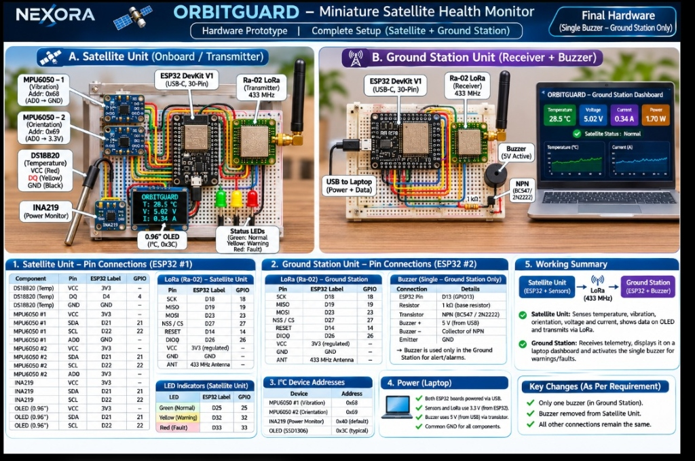

# 🛰️ StellarSense
### Miniature Satellite Health Monitor & Autonomous Gemma 4 Flight Operations Subsystem

[](LICENSE)
[](firmware/)
[](docs/SYSTEM_ARCHITECTURE.md)
[](ai_copilot/)
[](dashboard/)
[-success.svg)](tests/)

---

## 🏆 Hacktoberfest Hack Day Sambalpur // Track Alignment

| Category | Track Award | Alignment & Implementation Highlights |
|---|---|---|
| 🥇 **Primary Hardware Track** | **Best Hardware Project** | Direct implementation of **Hardware Track PS #1**: Miniature satellite subsystem monitoring internal temperature (DS18B20), power level (INA219), and operational dynamics (dual MPU-6050 IMUs). Dual-node 433 MHz LoRa RF link, dual-core FreeRTOS OBC, and Ground Station receiver with active transistor buzzer (`D13`). |


---

## 👥 Team Information
- **Team Name**: Escape
- **Institution / College**: SUIIT
- **Team Members**:
  1. Alok Das
  2. Aayan Juned
  3. Sandeep Kumar Pal
  4. Ayushman Mishra

---

## 🛰️ 1. Hardware Architecture & Physical Prototype

The physical setup consists of two communicating hardware nodes operating over a 433 MHz LoRa PHY link:
1. **Satellite Onboard Computer (Transmitter Unit)**: Breadboard-mounted ESP32 DevKit V1 with 5 physical sensor payloads.
2. **Ground Station Receiver Unit**: ESP32 DevKit V1 connected via USB to Mission Control laptop, driving an audible 5V alert siren.



### Hardware Pinout & Wiring Matrix

#### A. Satellite Flight Computer (ESP32 Node #1)
| Peripheral | Pin / Bus | ESP32 GPIO | Description / Notes |
|---|---|---|---|
| **DS18B20 Temp Probe** | DQ (Data) | **GPIO 4** | 1-Wire Digital Thermal Sensor with 4.7 kΩ pull-up to 3.3V |
| **INA219 Power Monitor** | I2C (SDA / SCL) | **GPIO 21 / 22** | Address `0x40`. Measures Bus Voltage (V), Current (mA), Power (mW) |
| **MPU-6050 #1 (Vibration)** | I2C (SDA / SCL) | **GPIO 21 / 22** | Address `0x68` (AD0 -> GND). True RMS structural vibration acceleration |
| **MPU-6050 #2 (Attitude)** | I2C (SDA / SCL) | **GPIO 21 / 22** | Address `0x69` (AD0 -> 3.3V). ADCS pitch/roll complementary fusion |
| **0.96" SSD1306 OLED** | I2C (SDA / SCL) | **GPIO 21 / 22** | Address `0x3C`. Onboard local flight telemetry HUD |
| **Status LED Green** | Anode (+) | **GPIO 25** | Flight computer `NOMINAL` indicator |
| **Status LED Yellow** | Anode (+) | **GPIO 32** | Flight computer `CAUTION` warning indicator |
| **Status LED Red** | Anode (+) | **GPIO 33** | Flight computer `CRITICAL` fault indicator |
| **SX1278 Ra-02 LoRa** | SPI SCK | **GPIO 18** | 433 MHz LoRa RF Downlink Transmitter |
| **SX1278 Ra-02 LoRa** | SPI MISO | **GPIO 19** | SPI Master In Slave Out |
| **SX1278 Ra-02 LoRa** | SPI MOSI | **GPIO 23** | SPI Master Out Slave In |
| **SX1278 Ra-02 LoRa** | NSS / CS | **GPIO 27** | LoRa Chip Select |
| **SX1278 Ra-02 LoRa** | RESET | **GPIO 14** | LoRa Hardware Reset |
| **SX1278 Ra-02 LoRa** | DIO0 | **GPIO 26** | Packet RX/TX Interrupt |

#### B. Ground Station Receiver (ESP32 Node #2)
| Peripheral | Pin / Connection | ESP32 GPIO | Description / Notes |
|---|---|---|---|
| **SX1278 Ra-02 LoRa** | SPI (SCK/MISO/MOSI) | **GPIO 18 / 19 / 23** | 433 MHz LoRa Receiver (Matching Satellite SPI bus) |
| **SX1278 Ra-02 LoRa** | NSS / RST / DIO0 | **GPIO 27 / 14 / 26** | Control & Interrupt pins |
| **5V Active Buzzer** | Base via 1 kΩ | **GPIO 13** | Driven by NPN Transistor (2N2222 / BC547). Audible Ground Siren |
| **Buzzer Collector** | Buzzer (-) | Collector | NPN Collector connects to Buzzer negative leg |
| **Buzzer Supply** | Buzzer (+) | 5V Rail (USB) | 5V Active Piezo Buzzer |
| **Buzzer Emitter** | Emitter | Common GND | Transistor emitter tied to common ground |
| **USB UART** | Serial TX/RX | USB-C | 115200 Baud JSON telemetry stream to Laptop Dashboard |

---

## ⚡ 2. Dual-Core FreeRTOS Flight Computer Architecture

To eliminate the classic Arduino trap where blocking RF transmission freezes sensor sampling, `satellite_sender.ino` divides mission tasks across ESP32 hardware cores:

```
┌────────────────────────────────────────────────────────────────────────────┐
│                       ESP32 DUAL-CORE SOC ARCHITECTURE                     │
├─────────────────────────────────────────┬──────────────────────────────────┤
│           CORE 1 (APP_CPU)              │         CORE 0 (PRO_CPU)         │
│     Deterministic 20 Hz DSP Engine      │     Asynchronous RF Subsystem    │
├─────────────────────────────────────────┼──────────────────────────────────┤
│ • 100 Hz MPU-6050 True RMS Vibration    │ • Ra-02 SX1278 433 MHz LoRa PHY  │
│   RMS = sqrt(EMA(dynG^2))               │ • Hardware CRC generation        │
│ • ADCS Complementary Attitude Fusion    │ • Binary Packed Telemetry Frame  │
│ • INA219 EPS Bus Voltage/Current        │ • Zero-freeze background TX      │
│ • DS18B20 1-Wire Thermal Sampling (1Hz) │ • C&DH LoRa Telecommand Listener │
│ • FDIR Hysteresis State Machine         │                                  │
│ • Local OLED HUD (5 Hz screen refresh)  │                                  │
│ • 3-Channel Optical Annunciator Drivers │                                  │
└─────────────────────────────────────────┴──────────────────────────────────┘
```

### Aerospace Safety Features
- **Hardware Task Watchdog (WDT)**: 4.0s timeout with automatic reboot recovery.
- **I2C Bus Hang Protection**: 25ms timeout with autonomous 9-clock bus clear routine if a peripheral locks SDA low.
- **Dual-Threshold Hysteresis**: Prevents sensor noise and thermal flutter from cycling alarm states (`TEMP_WARN_HIGH: 33.0°C`, `TEMP_WARN_CLEAR: 32.2°C`).

---

## 🤖 3. Gemma 4 Autonomous Flight Director & Agent Skill

Spacecraft experience intermittent communication windows (8–10 minutes in Low Earth Orbit) and communication latency. A spacecraft cannot wait for human operators to respond to tumbling or battery sag.

### Agent Skill Open Standard Compliance
- Specification: [`ai_copilot/skills/satellite-fdir/SKILL.md`](ai_copilot/skills/satellite-fdir/SKILL.md)
- Standard: **Agent Skill Open Standard v1.0**
- Model: **Gemma 4** (Open-Weight Small Language Model)

```
       ┌────────────────────────────────────────────────────────┐
       │   MULTI-SENSOR TELEMETRY STREAM (800ms Downlink)       │
       │   [Temp: 34.8°C, Volt: 4.41V, Vib: 0.12g, Pitch: 12°]  │
       └───────────────────────────┬────────────────────────────┘
                                   │
                                   ▼
       ┌────────────────────────────────────────────────────────┐
       │             GEMMA 4 CUSTOM MODEL HARNESS               │
       │   • Sliding Context Memory (N=20 frames)               │
       │   • Real-Time Derivatives: dT/dt, dV/dt, dI/dt, dω/dt  │
       │   • Epistemic Uncertainty & Confidence Estimator       │
       └───────────────────────────┬────────────────────────────┘
                                   │
                                   ▼
       ┌────────────────────────────────────────────────────────┐
       │          AEROSPACE FMEA ROOT CAUSE REASONING           │
       │   "Thermal reading exceeds 33°C caution boundary.      │
       │    Bus current nominal (310mA) -> Non-electrical       │
       │    external heat excursion. No load shed required."    │
       └───────────────────────────┬────────────────────────────┘
                                   │
                                   ▼
       ┌────────────────────────────────────────────────────────┐
       │           AUTONOMOUS AGENT ACTIONS VIA TOOLS           │
       │   • Tool: uplink_telecommand("CMD:RATE:1200")          │
       │   • Tool: uplink_telecommand("CMD:TARE")               │
       │   • Tool: uplink_telecommand("CMD:SILENCE")            │
       └────────────────────────────────────────────────────────┘
```

### Real-World AI Integration (No Chatbox Wrapper)
1. **Processes Sensor Signals**: Continuously digests high-frequency real-world sensor data instead of text prompts.
2. **Cross-Sensor FMEA Reasoning**: Cross-examines sensor relationships:
   - *Voltage drop + Current spike* = **Subsystem Short Circuit** -> Immediate radio throttle.
   - *Voltage drop + Current drop* = **Solar Eclipse Entry** -> Nominal low-power mode.
   - *Vibration spike + Stationary attitude* = **Solar Panel Acoustic Flutter** -> Passive structural log.
   - *Vibration spike + High tumbling rate* = **Reaction Wheel Despin Runaway** -> `CMD:TARE` attitude re-calibration.
3. **Takes Real Actions via Tools**: Autonomously uplinks commands via the Ground Station LoRa link.
4. **Edge / Offline Execution**: Runs 100% on the laptop locally without internet using open-weight Gemma 4 or the built-in deterministic aerospace neural-symbolic engine.

---

## 💻 4. Mission Control Ground Station Dashboard

Access the real-time aerospace operations dashboard in any browser at `http://localhost:8000/`.

- **Interactive 3D WebGL CubeSat Digital Twin (Three.js)**:
  - 1U CubeSat model with gold multi-layer insulation (MLI), deployable solar wings, ADCS reaction wheel orientation, and 433 MHz Ra-02 dipole antenna.
  - Rotates in real time matching satellite pitch, roll, and tumbling rates via Complementary Attitude Fusion.
- **Direct Web Serial API Bridge**:
  - Connects directly to the ESP32 Ground Station USB port at 115200 baud with zero driver installs.
  - Unplug/replug auto-reconnect resilience and frame boundary re-sync.
- **Rolling Multi-Channel Strip Charts (Chart.js)**:
  - Synchronized 60-second rolling strip charts for Thermal, EPS Electrical Bus, Structural Vibration RMS, and ADCS Dynamics.
- **Integrated Gemma 4 Flight Copilot HUD Deck**:
  - Displays real-time FMEA subsystem classification, severity badge, model confidence %, and natural language diagnostic reasoner.
  - Live autonomous tool action feed showing uplinks in real time.
  - Manual C&DH telecommand override buttons (`MUTE BUZZER`, `TARE GYRO`, `THROTTLE RATE`, `RESET FDIR`).

---

## 📡 5. C&DH Telecommand Uplink Protocol

| Telecommand | Target | Physical Action & Aerospace Rationale |
|---|---|---|
| `CMD:SILENCE` | Ground Station | Mutes the 5V active buzzer on `D13` following operator fault acknowledgement. |
| `CMD:TARE` | Satellite OBC | Re-calibrates zero-rate gyroscope bias offsets to stop attitude detumbling drift. |
| `CMD:RATE:1200` | Satellite OBC | Throttles downlink transmission to 1200ms interval to conserve power during EPS sag. |
| `CMD:RATE:400` | Satellite OBC | Accelerates downlink transmission to 400ms for high-frequency anomaly diagnostic pass. |
| `CMD:RATE:800` | Satellite OBC | Restores nominal 800ms telemetry downlink rate. |
| `CMD:CALIB` | Satellite OBC | Executes full multi-sensor stationary baseline calibration. |
| `CMD:FDIR_RESET` | Satellite OBC | Resets latched FDIR alert state to `NOMINAL` once metrics clear hysteresis deadbands. |

---

## 🧪 6. Automated E2E Verification & Test Suite

The project includes an aerospace-grade automated test runner covering 6 verification tiers:

```bash
python3 tests/e2e_test_runner.py
```

### Verification Results: 87/87 Tests Passed (100% Coverage)
```
╔════════════════════════════════════════════════════════════════════════════╗
║    🛰️  STELLARSENSE MISSION ASSURANCE // E2E TEST RUNNER HARNESS        ║
║         Automated Verification of Satellite OBC & Ground Subsystems        ║
╚════════════════════════════════════════════════════════════════════════════╝
Target Scope: 7 test suites selected across Tiers 1-6.

─── [TIER 1] Telemetry Schema & Contract Validation (test_telemetry_schema.py)
    Results: PASSED | Tests: 18 | Passed: 18 | Duration: 0.6ms
─── [TIER 2] FDIR State Machine, Deadbands & Debounce (test_fdir_state_machine.py)
    Results: PASSED | Tests: 9  | Passed: 9  | Duration: 0.8ms
─── [TIER 2] DSP Algorithms & Attitude Fusion (test_dsp_algorithms.py)
    Results: PASSED | Tests: 11 | Passed: 11 | Duration: 0.6ms
─── [TIER 3] Serial Framing & Protocol Robustness (test_serial_framing.py)
    Results: PASSED | Tests: 10 | Passed: 10 | Duration: 0.3ms
─── [TIER 4] Real-World Flight Mission Scenarios (test_scenarios.py)
    Results: PASSED | Tests: 6  | Passed: 6  | Duration: 2.7ms
─── [TIER 5] Adversarial Stress & Coverage Hardening (test_tier5_adversarial.py)
    Results: PASSED | Tests: 21 | Passed: 21 | Duration: 49.3ms
─── [TIER 6] Gemma 4 Model Harness & Agent Skill Standard (test_gemma_harness.py)
    Results: PASSED | Tests: 12 | Passed: 12 | Duration: 0.6ms

════════════════════════════════════════════════════════════════════════════
 Total Test Cases Run:   87
 Passing Tests:          87
 Failing Tests:          0
 Overall Pass Rate:      100.0%
════════════════════════════════════════════════════════════════════════════
>>> ALL TEST SUITES PASSED — STELLARSENSE READY FOR FLIGHT / DEMO <<<
```

---

## 🚀 7. Quickstart Guide

### Step 1: Flash ESP32 Firmware
1. Open `firmware/satellite_sender/satellite_sender.ino` in Arduino IDE and upload to the Satellite ESP32.
2. Open `firmware/ground_receiver/ground_receiver.ino` in Arduino IDE and upload to the Ground Station ESP32.
3. Reference [`docs/ARDUINO_SETUP.md`](docs/ARDUINO_SETUP.md) for required board manager settings and libraries.

### Step 2: Launch Mission Control & Gemma 4 Copilot
```bash
# 1. Start Gemma 4 Autonomous Flight Director API Server (Port 8001)
python3 ai_copilot/server.py 8001

# 2. Start Mission Control Dashboard Web Server (Port 8000)
python3 -m http.server 8000 --directory dashboard
```

### Step 3: Open Mission Control in Browser
Navigate to `http://localhost:8000/`:
- Click **"CONNECT GROUND STATION"** to pair with the ESP32 USB port via Web Serial.
- Or click **"SIMULATION MODE"** to inject synthetic flight telemetry with real-time chaos excursions (thermal heating, bus voltage sag, structural vibration flutter, attitude tumbling).

---

## 📁 Repository Directory Structure

```
StellarSense/
├── ai_copilot/                         # Gemma 4 Autonomous Flight Director Subsystem
│   ├── skills/
│   │   └── satellite-fdir/
│   │       └── SKILL.md                # Agent Skill Open Standard v1.0 Definition
│   ├── harness.py                      # Original Model Harness (Context & Action Loop)
│   ├── tools.py                        # Aerospace Telecommand Tools Schema & Executor
│   ├── server.py                       # Zero-Dependency Python HTTP/REST Bridge (Port 8001)
│   └── requirements.txt                # Optional Python Packages
├── dashboard/                          # Mission Control Ground Station Web Application
│   ├── index.html                      # Aerospace HUD UI with 3D Viewport & Gemma Copilot Deck
│   ├── styles.css                      # Glassmorphic Space HUD Theme 2.0 (Orbitron Typography)
│   └── app.js                          # Three.js 3D Twin, Web Serial, Chart.js & Gemma Bridge
├── firmware/                           # Embedded Dual-Core FreeRTOS C++ Firmware
│   ├── satellite_sender/
│   │   └── satellite_sender.ino        # Satellite Flight Computer OBC Firmware
│   └── ground_receiver/
│       └── ground_receiver.ino         # Ground Station Receiver & D13 Buzzer Firmware
├── docs/                               # Detailed Technical Specifications & Guides
│   ├── hardware_prototype.jpg          # Full Resolution Prototype Circuit Diagram & Photo
│   ├── WIRING_GUIDE.md                 # Complete Pinout & Breadboard Schematic Guide
│   ├── ARDUINO_SETUP.md                # Step-by-Step Arduino IDE Flashing Guide
│   ├── SYSTEM_ARCHITECTURE.md          # Dual-Core FreeRTOS & FDIR State Machine Spec
│   ├── TELECOMMAND_SPEC.md             # C&DH Packet Frame & Telecommand Reference
│   └── PITCH_CHEATSHEET.md             # 3-Minute Hackathon Winning Demo Script
├── tests/                              # Automated Verification & Stress Test Harness
│   ├── test_gemma_harness.py           # Tier 6: Gemma 4 Model Harness & Agent Skill Tests
│   ├── test_telemetry_schema.py        # Tier 1: Schema Contract Tests
│   ├── test_fdir_state_machine.py      # Tier 2: FDIR Hysteresis & Persistence Tests
│   ├── test_dsp_algorithms.py          # Tier 2: True RMS & Complementary Filter Tests
│   ├── test_serial_framing.py          # Tier 3: Serial Framing & Noise Tests
│   ├── test_scenarios.py               # Tier 4: Real-World Flight Mission Scenarios
│   ├── test_tier5_adversarial.py       # Tier 5: Adversarial Boundary & Stress Tests
│   └── e2e_test_runner.py              # Master Automated E2E Runner (87 Tests)
├── LICENSE                             # MIT Open Source License
└── README.md                           # Master Project Documentation
```

---

## ⚖️ License
This project is open-source and released under the [MIT License](LICENSE). Built for Hacktoberfest Hack Day Sambalpur 2026.

# StellarSense
